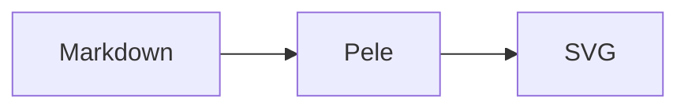

# Pele Mermaid Renderer for Obsidian

Render Mermaid diagrams in Obsidian with [Pele](https://pele.run): synchronous SVG output, seven curated themes, live preview, and per-diagram overrides.

## Features

- Replaces Obsidian's built-in `mermaid` code blocks with Pele.
- Supports both `mermaid` and `pele` fences.
- Seven themes: Obsidian, Flexoki, Nord, Solarized, Tokyo Night, Paper, GitHub.
- Light and dark palettes, with automatic appearance tracking.
- Per-diagram `%% theme:` and `%% scheme:` directives.
- Live Preview editing and reading view rendering.
- Zoom, pan, keyboard controls, print styles, and inline error feedback.
- Local rendering only; no network requests or telemetry.

## Install

Copy `main.js`, `manifest.json`, and `styles.css` into:

```text
<vault>/.obsidian/plugins/ob-pele/
```

Reload Obsidian, then enable **Pele Mermaid Renderer** under Settings → Community plugins.

To build and deploy from this repository:

```sh
npm install
npm run build
node scripts/deploy.mjs
```

The deploy script defaults to `I:/obsidiannote/paper-zettel`; override it with the `OBSIDIAN_VAULT` environment variable. Do not use `--enable` while Obsidian is running.

## Usage

````markdown

````

Without directives, diagrams use the global settings. Remove a directive to inherit the default theme and scheme.

Open the command palette and run **Pele Mermaid Renderer: 打开主题展示笔记** to create `Pele 主题展示.md` with all seven themes.

## Themes

| ID | Theme |
| --- | --- |
| `obsidian` | Follows the active Obsidian theme |
| `flexoki` | Warm paper and ink |
| `nord` | Cool Nordic blue-grey |
| `solarized` | Classic low-contrast palette |
| `tokyo` | Deep blue night with neon accents |
| `paper` | Monochrome print-friendly |
| `github` | Clean GitHub-style palette |

## Commands

- **重新渲染图表** — re-render all open diagrams.
- **切换图表主题** — cycle through the seven themes.
- **打开主题展示笔记** — create or open the theme showcase note.

## Documentation

- [使用手册](docs/使用手册.md) — installation, settings, directives, zoom, troubleshooting.
- [案例库](docs/案例.md) — 27 verified diagrams ready to copy.
- [Pele documentation](https://pele.run)

## Development

```sh
npm run build   # typecheck and bundle
npm run verify  # verify showcase, docs examples, units, and theme CSS
npm run deploy  # build and copy into the vault
```

`main.js` is generated; edit files under `src/` and `scripts/`. Pele is pinned to `1.7.0`.

## License

MIT
