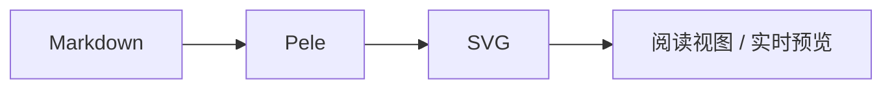
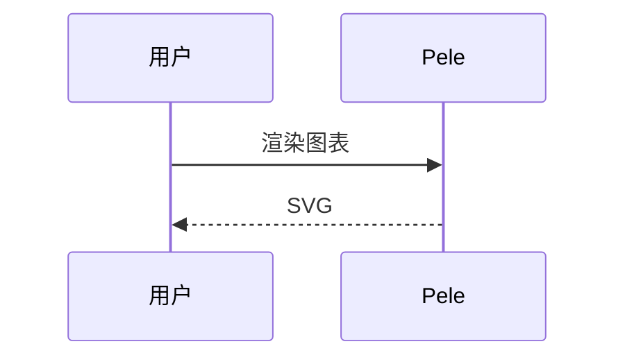

# Pele Mermaid Renderer 使用手册

> 版本 1.0.0 · 基于 Pele 1.7.0 · 适用于 Obsidian 1.5 及以上

Pele Mermaid Renderer 用 [Pele](https://pele.run) 接管 Obsidian 中的 `mermaid` 代码块，提供更快的同步渲染、七套配色、明暗模式和单图覆盖能力。渲染在本地完成，不上传笔记内容。

## 1. 安装与启用

### 1.1 确认插件文件

插件目录应包含以下三个文件：

```text
<你的库>/.obsidian/plugins/ob-pele/
├── main.js
├── manifest.json
└── styles.css
```

当前已部署到：

```text
I:\obsidiannote\paper-zettel\.obsidian\plugins\ob-pele\
```

### 1.2 启用

1. 重载 Obsidian：`Ctrl+R`（Windows/Linux）或 `Cmd+R`（macOS），也可以完全退出后重新打开。
2. 打开「设置 → 第三方插件」。
3. 如果「安全模式」或「限制模式」处于开启状态，先关闭。
4. 在已安装插件列表中找到 **Pele Mermaid Renderer**，打开开关。
5. 打开任意含 `mermaid` 代码块的笔记验证。

### 1.3 快速验证

打开命令面板（`Ctrl+P` / `Cmd+P`），运行：

```text
Pele Mermaid Renderer: 打开主题展示笔记
```

插件会在库根目录创建并打开 `Pele 主题展示.md`，其中包含七套主题的示例。

其他命令：

- **重新渲染图表**：手动刷新所有已打开笔记中的图表。
- **切换图表主题**：按顺序切换全局主题，不打开设置页也能快速预览。

## 2. 快速开始

在笔记中写一个普通的 Mermaid 代码块即可：



也支持 `pele` 作为代码块语言：

```pele
pie
  "Flowchart" : 42
  "Sequence" : 24
  "其他" : 34
```

两种写法没有功能差别。已有笔记不需要修改代码块语言。

## 3. 主题

插件内置七套主题。主题只影响图表配色，不改变 Obsidian 界面。

| 主题 ID | 名称 | 风格 |
| --- | --- | --- |
| `obsidian` | 跟随 Obsidian | 使用当前主题的背景、文字和强调色 |
| `flexoki` | Flexoki | 温暖纸张底色，克制的墨色 |
| `nord` | Nord | 冷冽的北欧蓝灰 |
| `solarized` | Solarized | 经典的低对比明暗配色 |
| `tokyo` | Tokyo Night | 深蓝夜色与霓虹高光 |
| `paper` | Paper | 单色纸墨，适合打印和长文 |
| `github` | GitHub | 清爽克制的 GitHub 风格 |

在「设置 → 第三方插件 → Pele Mermaid Renderer」中修改默认主题，设置会立即保存并刷新已打开的图表。

## 4. 明暗模式

每套固定主题都有浅色和深色两套调色板：

- `auto`：跟随 Obsidian 当前的明暗外观。
- `light`：固定使用浅色版本。
- `dark`：固定使用深色版本。

`obsidian` 主题始终读取 Obsidian 当前的界面变量。给 `obsidian` 主题强制指定 `light` 或 `dark` 不会改变界面配色，只会写入标记。

## 5. 单图覆盖

在代码块**最前面**加入指令，可以只覆盖当前图表：



规则：

- 指令必须位于代码块最前面，第一条图内容之前。
- 支持 `%% theme: <主题 ID>` 和 `%% scheme: auto|light|dark`。
- 也支持兼容写法 `%% pele-theme:`、`%% pele scheme:`。
- 如果使用 Mermaid 的 YAML frontmatter（`---`），把指令放在 frontmatter **之前**。
- 无效的主题名会保留为普通注释，图表使用全局设置。
- 图内容中间的 `%% theme:` 不会生效，以免误伤普通注释。

## 6. 设置项

| 设置 | 默认值 | 说明 |
| --- | --- | --- |
| 主题 | 跟随 Obsidian | 全局默认主题 |
| 明暗模式 | 跟随 Obsidian | 固定主题的浅色/深色版本 |
| 缩放 | 自动 | 自动、始终显示控件、关闭 |
| 窄屏自动转向 | 开启 | 容器较窄时允许横向流程图改为纵向 |
| 跟随笔记字体 | 开启 | 使用 Obsidian 正文字体 |
| 字体族 | 空 | 关闭「跟随笔记字体」后使用的 CSS 字体族 |
| 跟随笔记字号 | 开启 | 使用笔记正文字号 |
| 基准字号 | 16 px | 关闭「跟随笔记字号」后使用的字号，范围 10–32 px |

设置页顶部有实时预览，修改主题、明暗模式或缩放后可以立即看到效果。

## 7. 缩放与交互

- 图表宽度超出容器时，悬停会显示「放大 / 缩小 / 重置」按钮。
- `Ctrl` / `Cmd` + 滚轮：以指针位置为中心缩放。
- `+` / `-`：放大或缩小。
- 双击图表：在适配宽度和放大状态之间切换。
- 放大后拖拽：平移图表。
- `0` 或 `Esc`：重置缩放。
- 缩放按钮支持键盘操作，并带有中文辅助标签。

「自动」模式只在图表溢出时启用缩放；「始终」模式总是显示缩放按钮；「关闭」模式完全禁用缩放和平移。

## 8. 阅读视图与实时预览

- **阅读视图**：代码块会被直接替换为图表。
- **实时预览**：光标不在代码块内时显示图表；把光标移入代码块范围时恢复源码，方便直接编辑。
- 点击缩放按钮不会把光标带进代码块。
- 实时预览中，位于引用块或标注（callout）内的 `mermaid` 代码块暂不会被替换；阅读视图不受影响。需要编辑这类图表时，可以切换到阅读视图查看，或在源码模式编辑。

## 9. 支持的图表类型

Pele 目标兼容 Mermaid 12.1 语法。已在案例库中验证的常用类型包括：

flowchart、sequence、class、state、ER、gantt、pie、gitGraph、mindmap、timeline、journey、xychart、quadrantChart、requirement、C4、sankey、block、packet、kanban、architecture、radar、treemap、treeView、venn、cynefin、wardley、ishikawa。

此外还包含 swimlane、usecase、railroad、eventmodeling、agentflow 等类型，具体语法以 Pele 官方文档为准。

Pele 使用自己的布局和视觉风格，不保证与 Mermaid 官方渲染逐像素一致。个别类型对字段格式要求更严格，可直接参考 [案例库](案例.md)。

## 10. 故障排查

| 现象 | 可能原因 | 处理 |
| --- | --- | --- |
| 仍显示 Obsidian 内置 Mermaid | 插件未启用，或与其他 Mermaid 插件冲突 | 启用本插件；停用 `auto-beautiful-mermaid`、`beautiful-mermaid-renderer` 等接管 `mermaid` 的插件 |
| 图表不显示，只有源码 | 处于源码模式，或光标停在代码块内 | 切换到实时预览/阅读视图，或把光标移出代码块 |
| 主题没有变化 | 指令不在代码块最前面，或主题 ID 拼写错误 | 把 `%% theme:` 放到第一行；使用本文表格中的 ID |
| 明暗模式不生效 | 使用的是 `obsidian` 主题 | 该主题跟随界面；改用固定主题，或修改 Obsidian 外观 |
| 字体与笔记不一致 | 关闭了「跟随笔记字体」，或字体未安装 | 打开跟随选项；或在字体族中填写已安装字体 |
| 实时预览中引用块内不渲染 | 当前版本的限制 | 使用阅读视图查看，或在源码模式编辑 |
| 图表显示错误框 | Mermaid 语法不被 Pele 接受 | 根据错误信息修改语法；参考案例库中的可用写法 |
| 大图报错 | 超过 Pele 限制 | 源码上限约 50,000 字符、5,000 条边、输出上限约 4,000,000 字符；拆分图表 |

错误框会同时显示简短信息和原始源码。修复后图表会自动重新渲染。

## 11. 自定义主题（进阶）

插件主题全部通过 CSS 变量实现。可以在 `.obsidian/snippets/` 中新建 CSS 片段并启用，覆盖某套主题的变量。例如：

```css
.ob-pele-block[data-theme="nord"][data-scheme="dark"] {
  --pele-bg: #1e1e2e;
  --pele-fg: #cdd6f4;
  --pele-muted: #a6adc8;
  --pele-line: #cdd6f4;
  --pele-surface: #313244;
  --pele-surface-alt: #45475a;
  --pele-border: #585b70;
  --pele-accent: #89b4fa;
  --pele-critical: #f38ba8;
  --pele-series-1: #89b4fa;
  --pele-series-2: #fab387;
  --pele-series-3: #a6e3a1;
  --pele-series-4: #f38ba8;
  --pele-series-5: #94e2d5;
  --pele-series-6: #f9e2af;
  --pele-series-7: #cba6f7;
  --pele-series-8: #f5c2e7;
  --pele-radius: 8px;
}
```

可用的变量：

| 变量 | 用途 |
| --- | --- |
| `--pele-bg` | 图表背景 |
| `--pele-fg` | 主要文字 |
| `--pele-muted` | 次要文字 |
| `--pele-line` | 连线 |
| `--pele-surface` | 节点填充 |
| `--pele-surface-alt` | 次级节点填充 |
| `--pele-border` | 边框 |
| `--pele-accent` | 强调色 |
| `--pele-critical` / `--pele-error` | 错误与警示 |
| `--pele-series-1` … `--pele-series-8` | 图表系列色 |
| `--pele-font` / `--pele-font-mono` | 字体 |
| `--pele-radius` | 圆角 |

覆盖会影响所有使用该主题的图表。想保留预设，建议新增一个主题类名并通过 CSS 片段限定到特定笔记或容器。

## 12. 开发与验证

```text
npm install         安装依赖
npm run build       类型检查并生成 main.js
npm run verify      验证展示图表、案例图表和单元检查
node scripts/deploy.mjs
                    复制 main.js、manifest.json、styles.css 到库中
```

部署脚本默认使用 `I:/obsidiannote/paper-zettel`，可以通过环境变量覆盖：

```powershell
$env:OBSIDIAN_VAULT = "D:/Notes/MyVault"
node scripts/deploy.mjs
```

只有在 Obsidian 完全退出时才建议给部署脚本加 `--enable`；它会把 `ob-pele` 写入 `community-plugins.json`。Obsidian 运行时请手动在设置中启用。

## 13. 隐私与安全

- 所有解析和渲染都在本地完成，不发送笔记内容。
- Pele 会转义图表文本，并过滤链接协议；本插件允许 `http`、`https`、`mailto`、`tel` 和 `obsidian` 链接。
- 图表中的外部链接和图片是否加载，仍取决于链接目标和 Obsidian 的隐私设置。
- 插件不收集遥测数据。

## 14. 相关文档

- [案例库](案例.md)：可直接复制的 20+ 个图表案例。
- [Pele 官方文档](https://pele.run)：语法、主题变量和 API。
- [Pele API](https://pele.run/api)：`mount`、`render`、缩放和错误处理。
