# Pele Mermaid 案例库

这里收集了 27 个可直接复制的图表案例，覆盖流程、数据、计划、分析和系统架构等常见场景。

使用说明：

- 代码块可以直接粘贴到任意笔记中。
- 每个案例顶部的 `%% theme:` / `%% scheme:` 仅用于演示；删除后会跟随插件全局设置。
- 案例基于 Pele 1.7.0 验证，修改语法后如果报错，可对照错误框中的行号排查。
- 更完整的设置说明见 [使用手册](使用手册.md)。

## 一、流程与协作

### 1.1 发布流程

适合梳理从需求到上线的完整路径。

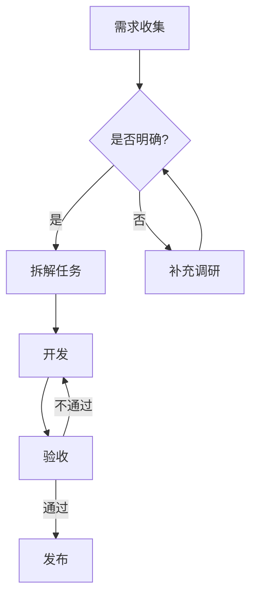

### 1.2 API 调用时序

适合描述客户端、服务端和数据库之间的交互。

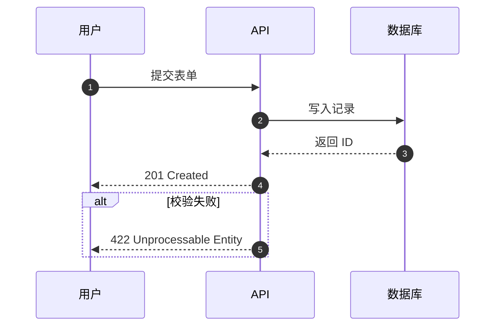

### 1.3 文档状态机

适合表示内容审核、订单流转等状态变化。

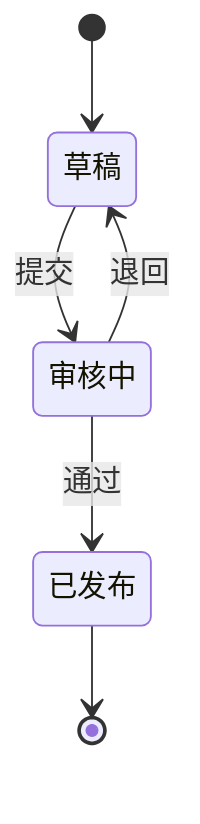

## 二、结构与数据

### 2.1 插件类图

适合表示类型、字段和方法之间的关系。

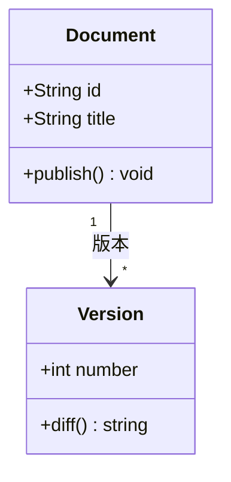

### 2.2 数据模型

适合快速画实体关系，不必先建完整数据库设计。

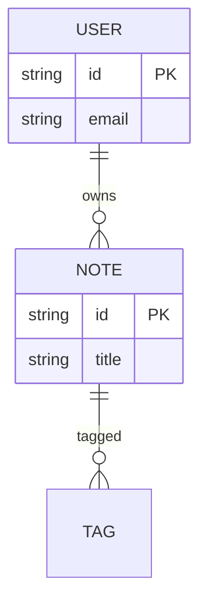

### 2.3 目录树

适合展示项目结构、知识分类或导出目录。


### 2.4 数据流

适合展示能量、流量、请求或转化路径的分配。

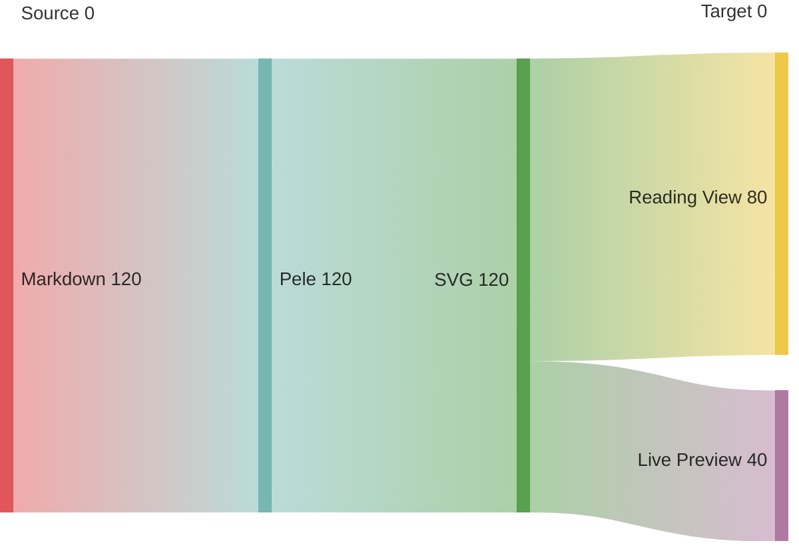

### 2.5 网络包结构

适合教学或协议说明，按位展示字段。

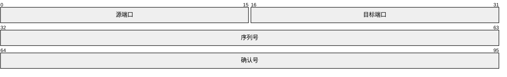

## 三、计划与时间

### 3.1 迭代计划

适合展示阶段、依赖和里程碑。

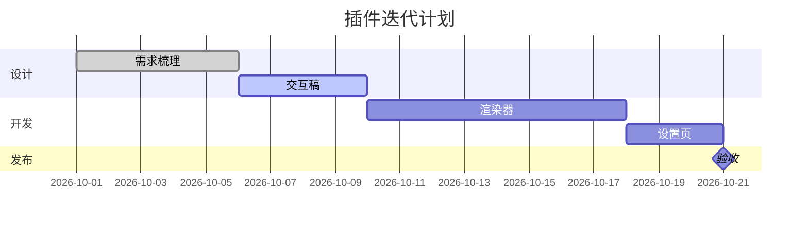

### 3.2 里程碑

适合按季度或阶段回顾重要事件。

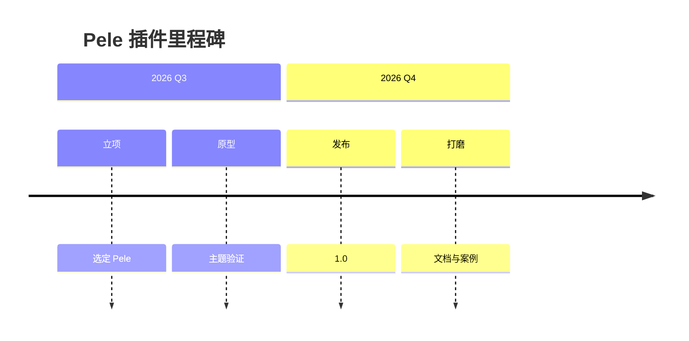

### 3.3 用户旅程

适合把体验拆成阶段，并标注情绪分数。

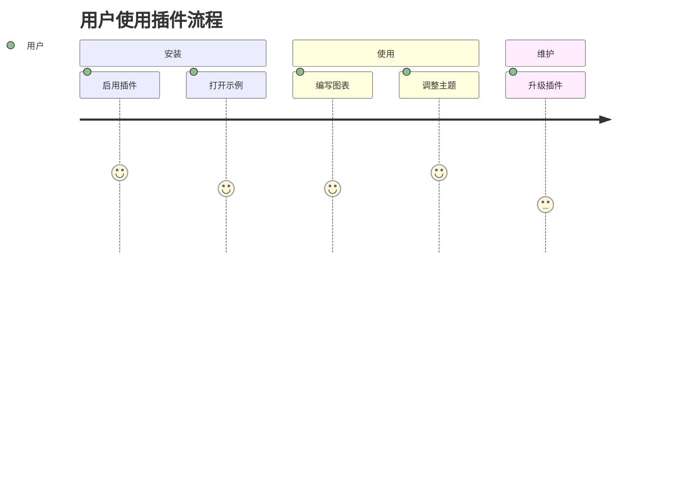

### 3.4 版本历史

适合展示分支、提交和合并策略。

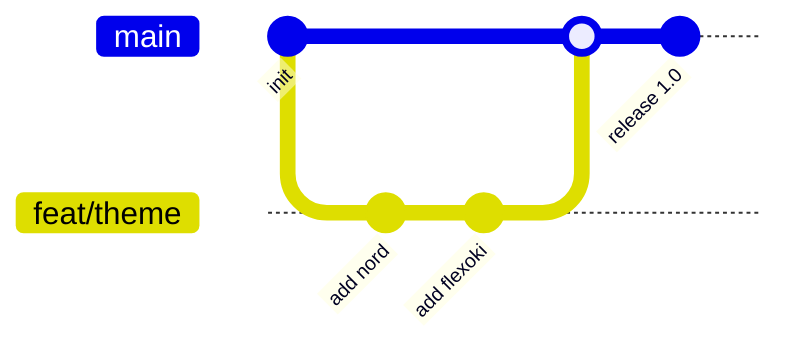

## 四、分析与决策

### 4.1 技术选型

适合把候选方案放到二维坐标中比较。

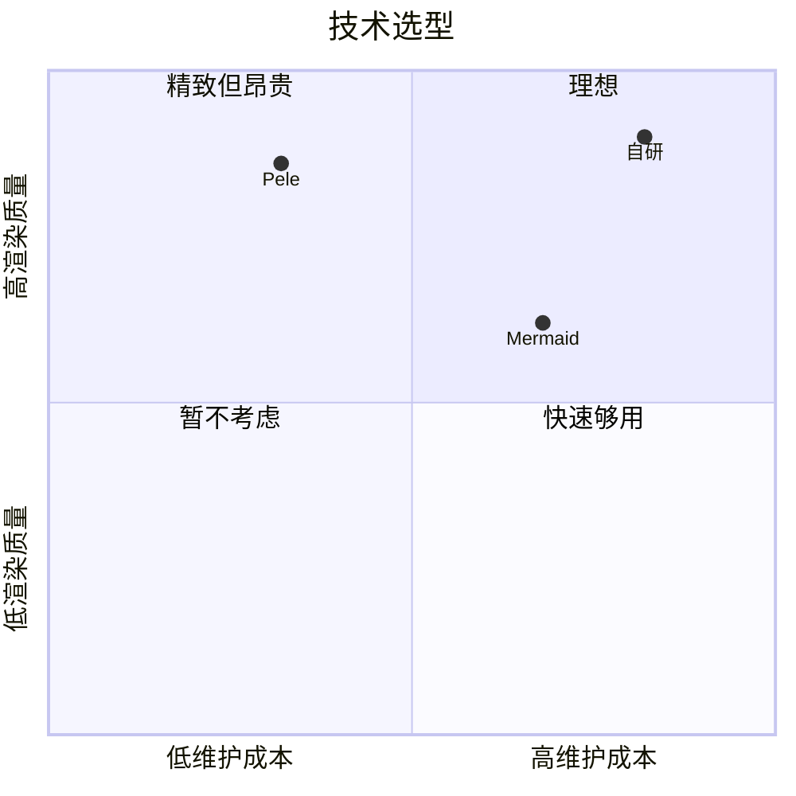

### 4.2 能力评估

适合比较多个维度的相对强弱。

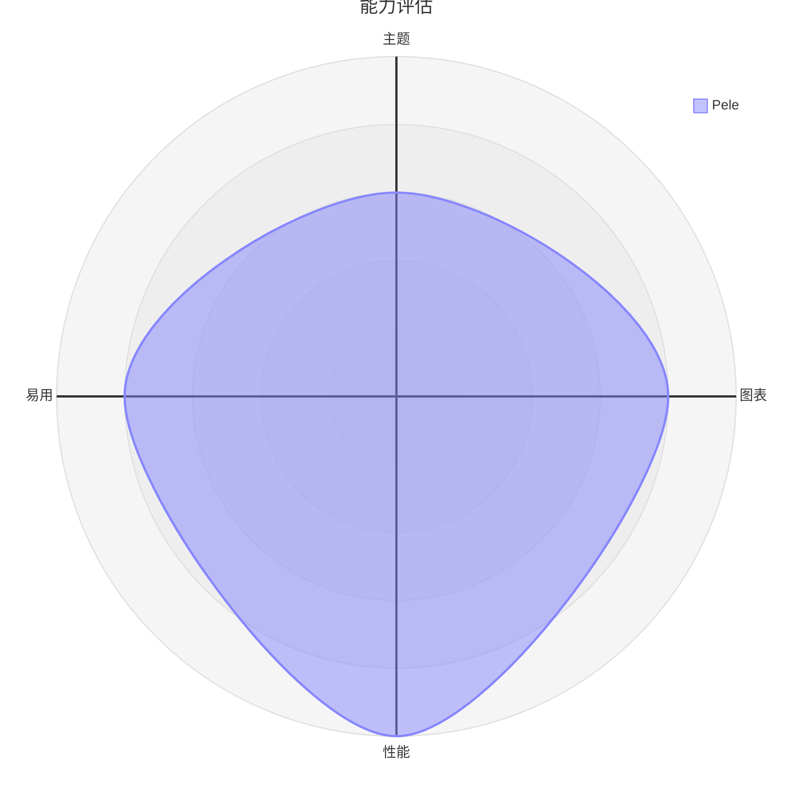

### 4.3 原因分析

适合做鱼骨图，把问题拆成可调查的原因。

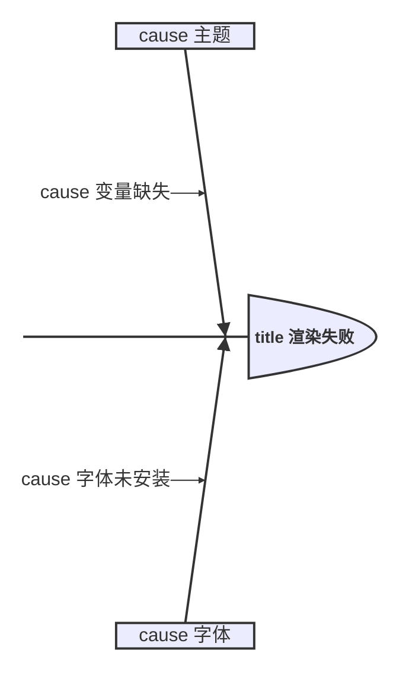

### 4.4 问题分类

适合用 Cynefin 框架判断问题应如何处理。

```mermaid
%% theme: solarized
%% scheme: light
cynefin-beta
  title 问题分类
  clear "明确问题"
  complicated "需要分析"
  complex "需要试验"
  chaotic "需要止损"
```

### 4.5 技术地图

适合展示组件在价值链中的位置和成熟度。

```mermaid
%% theme: github
%% scheme: dark
wardley-beta
  title 插件生态
  component user [0.9, 0.9]
  component pele [0.6, 0.5]
  user -> pele
```

### 4.6 功能覆盖

适合展示两个集合的并集、交集或差异。

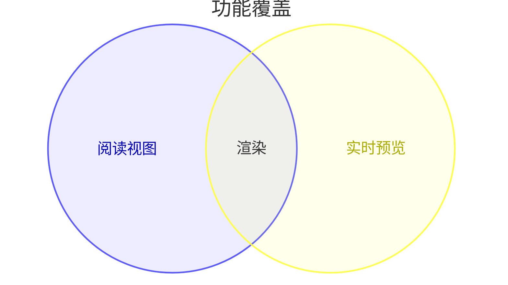

## 五、系统与知识

### 5.1 系统上下文

适合用 C4 模型说明用户、系统和外部依赖。

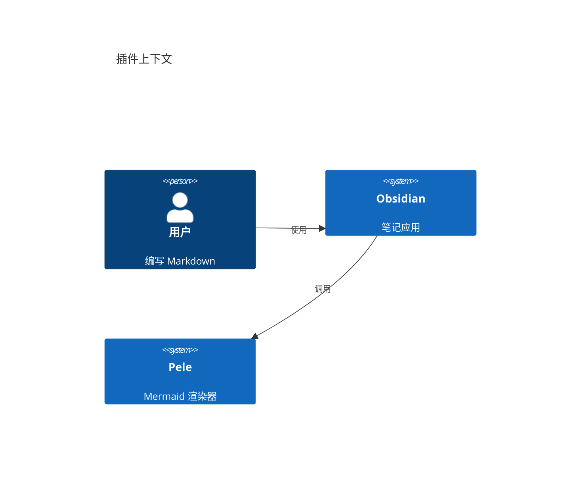

### 5.2 块图

适合快速表达模块和层级，不需要完整架构语法。

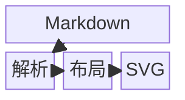

### 5.3 架构图

适合展示服务分组和调用方向。

```mermaid
%% theme: tokyo
%% scheme: dark
architecture-beta
  group app(cloud)[应用]
  service md(server)[Markdown] in app
  service render(server)[Pele] in app
  md:R --> L:render
```

### 5.4 需求关系

适合把需求、元素和满足关系画在一起。含非 ASCII 的 `text` 字段建议加引号。

```mermaid
%% theme: paper
%% scheme: light
requirementDiagram
  requirement req_theme {
    id: 1
    text: "支持每图覆盖"
    risk: low
    verifymethod: test
  }
  element diagram {
    type: diagram
  }
  diagram - satisfies -> req_theme
```

### 5.5 知识结构

适合把主题、子主题和关键词整理成脑图。

```mermaid
%% theme: flexoki
%% scheme: light
mindmap
  root((Pele))
    渲染
      SVG
      同步布局
    主题
      跟随 Obsidian
      七套预设
    覆盖
      阅读视图
      实时预览
```

### 5.6 任务看板

适合在笔记里维护简单的待办分组。

```mermaid
%% theme: solarized
%% scheme: light
kanban
  todo[待办]
    card1[设计主题]
    card2[补文档]
  doing[进行中]
    card3[验证示例]
  done[已完成]
    card4[渲染器]
```

### 5.7 比例

适合展示少量分类的占比。

```mermaid
%% theme: github
%% scheme: light
pie showData
  title 图表类型使用占比
  "Flowchart" : 42
  "Sequence" : 23
  "Timeline" : 15
  "其他" : 20
```

### 5.8 指标趋势

适合同时展示柱状和折线趋势。分类名含中文或空格时，建议加引号。

```mermaid
%% theme: tokyo
%% scheme: dark
xychart-beta
  title "月度渲染次数"
  x-axis "月份" ["7月", "8月", "9月", "10月"]
  y-axis "次数" 0 --> 500
  bar [120, 260, 380, 460]
  line [120, 260, 380, 460]
```

### 5.9 占比树图

适合展示层级数据的面积占比。

```mermaid
%% theme: flexoki
%% scheme: light
treemap-beta
"根"
  "主题"
    "Flexoki": 30
    "Nord": 20
  "图表"
    "Flowchart": 30
    "Sequence": 20
```

## 六、组合与改造建议

- 用 `%% theme:` 让同一页里的不同图表承担不同角色：概览用低对比主题，重点图用高对比主题。
- 删除指令即可让图表跟随全局设置，适合批量迁移旧笔记。
- 图表较宽时，把 `flowchart TD` 改成 `flowchart LR`，或调整设置中的「窄屏自动转向」。
- 需要打印时，使用 `paper` 主题 + `scheme: light`，并关闭缩放控件。
- 如果某个类型报错，先换回案例中的最小结构，再逐步添加节点和字段，通常能快速定位问题。
